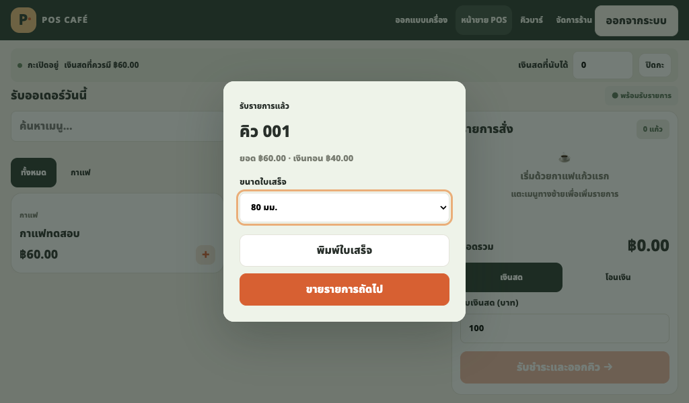
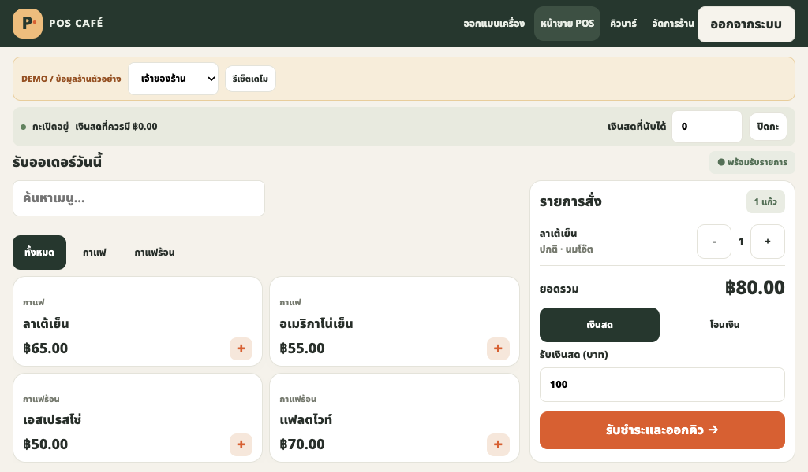

<div align="center">

# POS Café Maker
## ระบบร้านคาเฟ่บน Windows พร้อมพิมพ์เขียวเครื่อง POS

**ระบบร้านบน PostgreSQL · หลายหน้าจอใน LAN · ไม่ใช้ Docker · เคส 3D และ KiCad แก้ต่อได้**

แจกแบบ CAD และ source ที่ใช้งานแก้ไขได้ พร้อม [ที่มาข้อมูลและใบบันทึกอุปกรณ์](docs/BLUEPRINT.md) ขนาดจอเริ่มต้นอ้างอิง Waveshare 7inch HDMI LCD (C) จากเอกสารผู้ผลิต บอร์ดทั่วไป/พัดลมเป็นแม่แบบขนาดสมมติ ส่วนขอบบอร์ด รูและ net ของ PCB accessory มาจาก KiCad ใน repo ต้องตรวจอุปกรณ์จริงก่อนผลิต

รุ่น 0.1.2 เก็บมุมเคส ฐานเป็นแท่นรองด้านหลังขันยึดกับฝา มีตัวประคองขอบหลังจอและช่องรัดสาย หน้าขายใช้ปุ่มเมนูแบบข้อความและตะกร้าชำระเงินในพื้นที่จอ 1024×600 ดู [วิธีประกอบ](docs/PRINTING.md) แบบยังไม่ผ่านการประกอบจริง

[](https://github.com/boombignose/pos-cafe-maker/actions/workflows/ci.yml)

[เปิดเดโมออนไลน์](https://boombignose.github.io/pos-cafe-maker/) · [เริ่มใช้](#quick-start) · [ออกแบบและพิมพ์](docs/DESIGNER.md) · [วงจรและ PCB](docs/HARDWARE.md) · [ผลตรวจ](docs/TEST-REPORT.md)

[ดาวน์โหลด Source ZIP](https://github.com/boombignose/pos-cafe-maker/archive/refs/heads/main.zip) · [ชุดระบบร้านและเดโม](https://github.com/boombignose/pos-cafe-maker/releases/tag/v0.2.0)


</div>

> **เลือกให้ตรงโหมด:** `shop ZIP` เป็นระบบร้านที่ใช้ฐานข้อมูลกลางและบัญชีจริง ส่วนเว็บ Pages และ `demo ZIP` เป็นข้อมูลจำลองใน browser ทั้งคู่ใช้ซอร์สเดียวกัน แต่แยกชุด build ชัดเจน เคส/PCB ยังไม่ผ่านการผลิตและประกอบจริง

## ใช้ระบบร้านบน Windows

1. ติดตั้ง [Node.js 24 LTS](https://nodejs.org/en/download) และ [PostgreSQL 17 หรือ18](https://www.postgresql.org/download/windows/) จากผู้ผลิต
2. ดาวน์โหลด `pos-cafe-maker-shop-v0.2.0.zip` จาก [Release](https://github.com/boombignose/pos-cafe-maker/releases/tag/v0.2.0) แตกไฟล์ แล้วดับเบิลคลิก **Start.cmd** ครั้งแรกต้องมีอินเทอร์เน็ตเพื่อติดตั้ง npm dependencies ไม่มี API key หรือ Docker
3. ใช้รหัสใน `SETUP-TOKEN.txt` ที่เครื่องร้านตั้งชื่อร้านและบัญชีเจ้าของผ่านเว็บ ไม่มีรหัสเริ่มต้นร่วมกัน เพิ่มวัตถุดิบ/เมนู/บัญชีทีมตามร้านจริง แล้วเปิดกะ
4. เครื่องลูกเปิด URL LAN ที่ Start แสดง ข้อมูลอยู่ PostgreSQL ของเครื่องกลาง รีสตาร์ต/เปลี่ยนโฟลเดอร์โปรแกรมแล้วข้อมูลยังอยู่ สำรองผ่านหน้า **ตั้งค่าร้าน** หรือ Backup.cmd กู้เข้า database ใหม่โดยเก็บต้นฉบับไว้

อ่าน [คู่มือติดตั้ง LAN สำรอง กู้คืน และอัปเดต](docs/INSTALL.md) ก่อนใช้ HTTP ไม่เข้ารหัสข้อมูลระหว่างเครื่อง ใช้เฉพาะเครือข่ายร้านที่เชื่อถือได้หรือให้ผู้ดูแลติดตั้ง HTTPS ผลตรวจโปรแกรมไม่แทนการทดสอบเครื่องพิมพ์และการทดลองร้านของคุณ

สำหรับผู้ที่ต้องการเตรียม Docker มี [คู่มือติดตั้ง Docker Desktop และ WSL 2 บน Windows](docs/DOCKER-WINDOWS.md) พร้อมตรวจ engine/Compose และแก้ปัญหาเบื้องต้น คู่มือนี้ยังไม่ใช่ชุดรัน POS ด้วย Docker; รุ่นนี้ใช้ `Start.cmd` ตามขั้นตอนข้างบน



ภาพเป็นรายการทดสอบบนฐานข้อมูลจริง ไม่ใช่ยอดขายหรือเงินที่รับจากลูกค้าจริง

## ในชุดนี้มีอะไร

| ออกแบบเครื่อง | ลองขายคาเฟ่ | วงจรเสริม | ส่งต่อทำของจริง |
|---|---|---|---|
| ขนาดจอ/เคส · บอร์ด · รูยึด · ช่องพอร์ต · มุมฐาน | เมนู/ตัวเลือก · เงินสด/โอนจำลอง · คิวบาร์ · กะ · สต็อกสูตร · CSV | บอร์ดเสริม 5V · ฟิวส์ · ป้องกันกลับขั้ว · พัดลม · ไฟสถานะ | STL แยก4ชิ้น · JSON · KiCad · BOM · Gerber · drill · STEP |

### <a id="quick-start"></a>ลองเดโม / พัฒนาจากซอร์ส

ต้องมี **Node.js 22.12+ หรือ Node.js 24 LTS** และ npm ไม่ต้องใส่ API key

```sh
git clone https://github.com/boombignose/pos-cafe-maker.git
cd pos-cafe-maker
npm ci
npm run dev
```

1. เปิด URL ที่ Vite แสดง โดยปกติ `http://localhost:5173` แล้วเข้า **ออกแบบเครื่อง** วัดขนาดอุปกรณ์จริงก่อนปรับแบบ
2. เข้า **หน้าขาย POS** → เปิดกะ → เลือกเมนู → รับเงินจำลอง → ออกคิว เลือกบทบาทด้านบนเพื่อลองแคชเชียร์หรือบาร์
3. ดาวน์โหลด STL/JSON จากหน้าออกแบบ เปิดใน slicer และดู [คู่มือ PCB](docs/HARDWARE.md) ก่อนสั่งพิมพ์หรือส่งผลิต

ถ้าดาวน์โหลด Source ZIP ให้แตกไฟล์ เปิด Terminal ในโฟลเดอร์นั้น แล้วเริ่มจาก `npm ci` หน้า HTML ต้องเปิดผ่านเว็บเซิร์ฟเวอร์ ไม่ใช่ดับเบิลคลิกซอร์ส `index.html`

### เดโม browser สำเร็จรูปจาก Release

ดาวน์โหลดไฟล์ `pos-cafe-maker-demo-v0.2.0.zip` แตกไฟล์ แล้วรัน:

```sh
cd pos-cafe-maker-demo
python3 -m http.server 8080 --bind 127.0.0.1
```

เปิด `http://localhost:8080` ไม่มี npm/Docker/ฐานข้อมูลสำหรับแพ็กเกจเดโมที่ build แล้ว ต้องดาวน์โหลดไฟล์นี้จาก Release ไม่ใช่ Source ZIP หน้าเว็บและข้อมูลจำลองทำงานได้โดยไม่ใช้บริการออนไลน์หลังดาวน์โหลด

## ลอง workflow ร้าน



ทั้งโหมดร้านและเดโม หน้าขายเลือกหมวดและเมนู เพิ่มจำนวน เลือกขนาด/ชนิดนม คำนวณเงินทอน และพิมพ์ใบเสร็จตัวอย่าง58/80มม. โหมดร้านพนักงานต้องตรวจยอดโอนจริงก่อนยืนยัน ส่วนเดโมจำลองการตรวจ ไม่มีการเชื่อมธนาคาร

คิวบาร์อัปเดตทุก2วินาที เริ่มทำ → พร้อมรับ → ส่งมอบ เจ้าของร้านดูเมนู/สูตร รับวัตถุดิบ ปรับสต็อกพร้อมเหตุผล ดูรายงานและคืนเงินทั้งบิลได้ สูตรและราคาของบิลเก่ายังอ้างอิงตอนขาย คืนวัตถุดิบเฉพาะคิวที่ยังไม่เริ่มทำ

**เฉพาะโหมดเดโม:** ข้อมูลเก็บใน `localStorage` ของ origin นี้ การล้างข้อมูลเว็บไซต์ เปลี่ยน browser/profile/port หรือกดรีเซ็ตเดโมอาจทำข้อมูลเดโมหาย บทบาทเป็นการจำลอง ไม่มีรหัสผ่านจริงหรือการรับรองความปลอดภัยหลายผู้ใช้ **อย่ากรอกรหัสผ่านหรือข้อมูลลูกค้าจริง** ข้อมูลจำลองไม่ส่งออกไปเซิร์ฟเวอร์

## ออกแบบเคสและ PCB

- จอและกล่องปรับเป็นมิลลิเมตร พรีวิวประกอบ/แยกชิ้น/โปร่งใส ใช้ geometry เดียวกับ STL
- วางบอร์ดและพัดลม ปรับรูยึด ตำแหน่ง/มุมหมุนในระนาบ PCB ช่องพอร์ตและพื้นที่เผื่อสาย ตรวจเตียงพิมพ์และพื้นที่ชน
- ส่งออก `frame.stl`, `body.stl`, `lid.stl`, `base.stl` และ `design.json` จอ บอร์ดและสายอ้างอิงไม่มีในไฟล์พิมพ์
- [ไฟล์ตัวอย่าง](examples/models/) และ [คู่มือวัด/พิมพ์](docs/DESIGNER.md) ค่าเริ่มต้นจอ164.90×106.96×8มม., active154.21×85.92มม. อ้างอิง [Waveshare 7inch HDMI LCD (C)](https://www.waveshare.com/wiki/7inch_HDMI_LCD_%28C%29) ยังต้องตรวจ revision พอร์ต แนว active area และพื้นที่กดล็อกของชิ้นจริง
- [บอร์ด PCB เสริม](hardware/sources/) มี source KiCad10, สัญลักษณ์/footprint ใน repo, [BOM](hardware/BOM.csv), ผังสาย และ [ไฟล์ผลิต](hardware/manufacturing/) แบบยังเป็นต้นแบบ
- ไฟDC5Vสำหรับพัดลม/LEDใช้บอร์ดเสริม คอมพิวเตอร์และจอใช้แหล่งจ่ายตามผู้ผลิตแยกกัน PCB นี้ไม่ใช่แหล่งจ่ายไฟ SBC และไม่ต่อไฟบ้าน
- เมื่อแก้ PCB ใช้เครื่องมือ [ส่งกลับ manifest](docs/HARDWARE.md) นำ JSON เข้าเว็บแล้วปรับรูยึด/พื้นที่ชิ้นส่วนใหม่ `STEP` ที่แจกเป็นตัวบอร์ดและทองแดง ส่วนชิ้นส่วนในเว็บเป็น envelope สำหรับเผื่อพื้นที่

## ตรวจและสร้างไฟล์เอง

```sh
npm test
npm run build
npm run models
python3 -m unittest discover -s tests -p 'hardware*_test.py'
python3 scripts/hardware/validate_export.py --check
python3 scripts/hardware/return_manifest.py hardware/sources/accessory.kicad_pcb hardware/board.json --check
```

[รายงานทดสอบ](docs/TEST-REPORT.md) แยกการตรวจเว็บ/geometry/ERC/DRC ออกจากการพิมพ์ ประกอบ โหลดไฟ และความร้อน ไม่มีหลักฐานการพิมพ์เคสหรือผลิตบอร์ดจริงในรุ่นนี้

## ระบบกลางและการพัฒนาต่อ

Express/PostgreSQL ใน `server/` เป็นระบบกลางของ shop mode เซิร์ฟเวอร์ตรวจสิทธิ์ owner/cashier/bar คิดราคาเอง เก็บเงินเป็นสตางค์ และทำ checkout/stock/refund ใน transaction พร้อม idempotency key และ row locks เมื่อคำตอบชำระหาย browser เก็บ intent เดิม ล็อกตะกร้า และตรวจผลเดิมหลัง reload/login ได้ เมื่อกู้ backup จะเปลี่ยน store epoch เพื่อห้ามส่งรายการค้างจากก่อนกู้ซ้ำ จนกว่าเจ้าของตรวจและบันทึกเหตุผล

พัฒนาจาก source ใช้ `npm ci` → `npm run build:shop` → `npm run shop` ส่วน `npm run build` ปกติยังเป็นเดโม [BACKEND.md](docs/BACKEND.md) อธิบาย API และการใช้ PostgreSQL ภายนอก [ผลตรวจ](docs/TEST-REPORT.md) แยก OS/ฐานข้อมูล/browser/ฮาร์ดแวร์อย่างชัดเจน

รุ่นแรก:ร้านเดียว ไม่มีโต๊ะ หลายสาขา payment gateway ใบกำกับภาษี offline checkout หรือ Windows service เครื่องพิมพ์ใบเสร็จผ่าน browser และไดรเวอร์ OS

## License

ซอฟต์แวร์และสคริปต์: [MIT](LICENSE) · แบบฮาร์ดแวร์/ไฟล์ผลิต/แบบตัวอย่าง: [CERN-OHL-P-2.0](hardware/LICENSE.md) พร้อม [ข้อความ license](LICENSES/CERN-OHL-P-2.0.txt) เอกสารผู้ผลิตและชื่อสินค้าเป็นของเจ้าของเดิม ดู [เครดิต dependencies](THIRD_PARTY.md)
