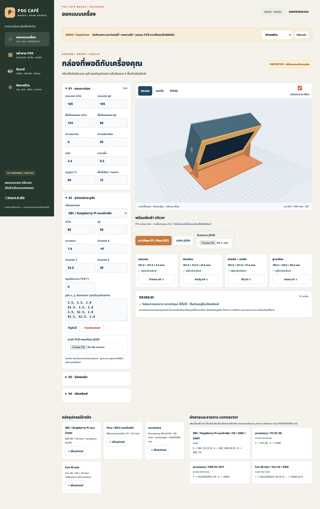
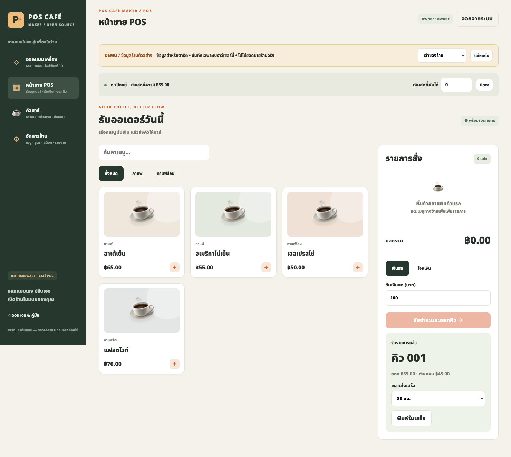

<div align="center">

# POS Café Maker
## ออกแบบเครื่องเอง ลองขายเอง แล้วพิมพ์เคสไปประกอบต่อ

**เดโม POS ภาษาไทย · ออกแบบเคส 3D · วางอุปกรณ์และวงจร · ไฟล์ KiCad แก้ต่อได้**

[](https://github.com/boombignose/pos-cafe-maker/actions/workflows/ci.yml)

[เปิดเดโมออนไลน์](https://boombignose.github.io/pos-cafe-maker/) · [เริ่มใช้](#quick-start) · [ออกแบบและพิมพ์](docs/DESIGNER.md) · [วงจรและ PCB](docs/HARDWARE.md) · [ผลตรวจ](docs/TEST-REPORT.md)

[ดาวน์โหลด Source ZIP](https://github.com/boombignose/pos-cafe-maker/archive/refs/heads/main.zip) · [ชุดไฟล์พร้อมลอง](https://github.com/boombignose/pos-cafe-maker/releases)



</div>

> **รุ่นนี้เป็นเดโมก่อน ไม่ต้องใช้ Docker หรือฐานข้อมูล** หน้าขาย คิวบาร์ สูตร สต็อกและรายงานใช้ข้อมูลจำลองในเบราว์เซอร์เครื่องนี้ ไม่ใช่ระบบรับเงินจริงหลายเครื่อง ส่วน STL และ KiCad เป็นไฟล์จริงที่แก้ต่อได้ ฮาร์ดแวร์ยังไม่ผ่านการพิมพ์และทดสอบทางกายภาพ

## ในชุดนี้มีอะไร

| ออกแบบเครื่อง | ลองขายคาเฟ่ | วงจรเสริม | ส่งต่อทำของจริง |
|---|---|---|---|
| ขนาดจอ/เคส · บอร์ด · รูยึด · ช่องพอร์ต · มุมฐาน | เมนู/ตัวเลือก · เงินสด/โอนจำลอง · คิวบาร์ · กะ · สต็อกสูตร · CSV | บอร์ดเสริม 5V · ฟิวส์ · ป้องกันกลับขั้ว · พัดลม · ไฟสถานะ | STL แยก4ชิ้น · JSON · KiCad · BOM · Gerber · drill · STEP |

### <a id="quick-start"></a>เริ่มใช้ใน 3 ขั้น

ต้องมี **Node.js 22.12+ หรือ Node.js 24 LTS** และ npm ไม่ต้องใส่ API key

```sh
git clone https://github.com/boombignose/pos-cafe-maker.git
cd pos-cafe-maker
npm ci
npm run dev
```

1. เปิด URL ที่ Vite แสดง โดยปกติ `http://localhost:5173` แล้วเข้า **ออกแบบเครื่อง** วัดขนาดอุปกรณ์จริงก่อนปรับแบบ
2. เข้า **หน้าขาย POS** → เปิดกะ → เลือกเมนู → รับเงินจำลอง → ออกคิว เลือกบทบาทด้านบนเพื่อลองแคชเชียร์หรือบาร์
3. ดาวน์โหลด STL/JSON จากหน้าออกแบบ เปิดใน slicer และดู [คู่มือ PCB](docs/HARDWARE.md) ก่อนสั่งพิมพ์หรือส่งผลิต

ถ้าดาวน์โหลด Source ZIP ให้แตกไฟล์ เปิด Terminal ในโฟลเดอร์นั้น แล้วเริ่มจาก `npm ci` หน้า HTML ต้องเปิดผ่านเว็บเซิร์ฟเวอร์ ไม่ใช่ดับเบิลคลิกซอร์ส `index.html`

### เดโมสำเร็จรูปจาก Release

ดาวน์โหลดไฟล์ `pos-cafe-maker-demo-v0.1.0.zip` แตกไฟล์ แล้วรัน:

```sh
cd pos-cafe-maker-demo
python3 -m http.server 8080 --bind 127.0.0.1
```

เปิด `http://localhost:8080` ไม่มี npm/Docker/ฐานข้อมูลสำหรับแพ็กเกจเดโมที่ build แล้ว ต้องดาวน์โหลดไฟล์นี้จาก Release ไม่ใช่ Source ZIP หน้าเว็บและข้อมูลจำลองทำงานได้โดยไม่ใช้บริการออนไลน์หลังดาวน์โหลด

## ลอง workflow ร้าน



หน้าขายเลือกหมวดและเมนู เพิ่มจำนวน เลือกขนาด/ชนิดนม คำนวณเงินทอน และพิมพ์ใบเสร็จตัวอย่าง58/80มม. การโอนใช้ checkbox **จำลองว่าพนักงานตรวจยอดแล้ว** ไม่มีการเชื่อมธนาคาร

คิวบาร์อัปเดตทุก2วินาที เริ่มทำ → พร้อมรับ → ส่งมอบ เจ้าของร้านดูเมนู/สูตร รับวัตถุดิบ ปรับสต็อกพร้อมเหตุผล ดูรายงานและคืนเงินทั้งบิลได้ สูตรและราคาของบิลเก่ายังอ้างอิงตอนขาย คืนวัตถุดิบเฉพาะคิวที่ยังไม่เริ่มทำ

ข้อมูลเก็บใน `localStorage` ของ origin นี้ การล้างข้อมูลเว็บไซต์ เปลี่ยน browser/profile/port หรือกดรีเซ็ตเดโมอาจทำข้อมูลเดโมหาย บทบาทเป็นการจำลอง ไม่มีรหัสผ่านจริงหรือการรับรองความปลอดภัยหลายผู้ใช้ **อย่ากรอกรหัสผ่านหรือข้อมูลลูกค้าจริง** ข้อมูลจำลองไม่ส่งออกไปเซิร์ฟเวอร์

## ออกแบบเคสและ PCB

- จอและกล่องปรับเป็นมิลลิเมตร พรีวิวประกอบ/แยกชิ้น/โปร่งใส ใช้ geometry เดียวกับ STL
- วางบอร์ดและพัดลม ปรับรูยึด ตำแหน่ง/มุมหมุนในระนาบ PCB ช่องพอร์ตและพื้นที่เผื่อสาย ตรวจเตียงพิมพ์และพื้นที่ชน
- ส่งออก `frame.stl`, `body.stl`, `lid.stl`, `base.stl` และ `design.json` จอ บอร์ดและสายอ้างอิงไม่มีในไฟล์พิมพ์
- [ไฟล์ตัวอย่าง](examples/models/) และ [คู่มือวัด/พิมพ์](docs/DESIGNER.md) ค่าเริ่มต้นจอ165×105×6มม. เป็นขนาดตัวอย่าง ไม่ได้ยืนยันว่าตรงสินค้ารุ่นใด
- [บอร์ด PCB เสริม](hardware/sources/) มี source KiCad10, สัญลักษณ์/footprint ใน repo, [BOM](hardware/BOM.csv), ผังสาย และ [ไฟล์ผลิต](hardware/manufacturing/) แบบยังเป็นต้นแบบ
- ไฟDC5Vสำหรับพัดลม/LEDใช้บอร์ดเสริม คอมพิวเตอร์และจอใช้แหล่งจ่ายตามผู้ผลิตแยกกัน PCB นี้ไม่ใช่แหล่งจ่ายไฟ SBC และไม่ต่อไฟบ้าน
- เมื่อแก้ PCB ใช้เครื่องมือ [ส่งกลับ manifest](docs/HARDWARE.md) นำ JSON เข้าเว็บแล้วปรับรูยึด/พื้นที่ชิ้นส่วนใหม่ `STEP` ที่แจกเป็นตัวบอร์ดและทองแดง ส่วนชิ้นส่วนในเว็บเป็น envelope สำหรับเผื่อพื้นที่

## ตรวจและสร้างไฟล์เอง

```sh
npm test
npm run build
npm run models
python3 -m unittest discover -s tests -p 'hardware*_test.py'
python3 scripts/hardware/validate_export.py --check
python3 scripts/hardware/return_manifest.py hardware/sources/accessory.kicad_pcb hardware/board.json --check
```

[รายงานทดสอบ](docs/TEST-REPORT.md) แยกการตรวจเว็บ/geometry/ERC/DRC ออกจากการพิมพ์ ประกอบ โหลดไฟ และความร้อน ไม่มีหลักฐานการพิมพ์เคสหรือผลิตบอร์ดจริงในรุ่นนี้

## ระบบฐานข้อมูลสำหรับต่อยอด

มี Express/PostgreSQL source และ integration tests ใน `server/` เป็น **ส่วนทดลองเพิ่มเติม** เดโมหลักไม่ใช้และไม่ต้องติดตั้ง อ่าน [BACKEND.md](docs/BACKEND.md) ก่อนนำไปพัฒนาต่อ ต้องผ่าน integration, backup/restore และการตรวจบนระบบเป้าหมายก่อนใช้งานร้านจริง ไม่รองรับหลายสาขา โต๊ะร้านอาหาร payment gateway หรือใบกำกับภาษี

## License

ซอฟต์แวร์และสคริปต์: [MIT](LICENSE) · แบบฮาร์ดแวร์/ไฟล์ผลิต/แบบตัวอย่าง: [CERN-OHL-P-2.0](hardware/LICENSE.md) พร้อม [ข้อความ license](LICENSES/CERN-OHL-P-2.0.txt) เอกสารผู้ผลิตและชื่อสินค้าเป็นของเจ้าของเดิม ดู [เครดิต dependencies](THIRD_PARTY.md)
